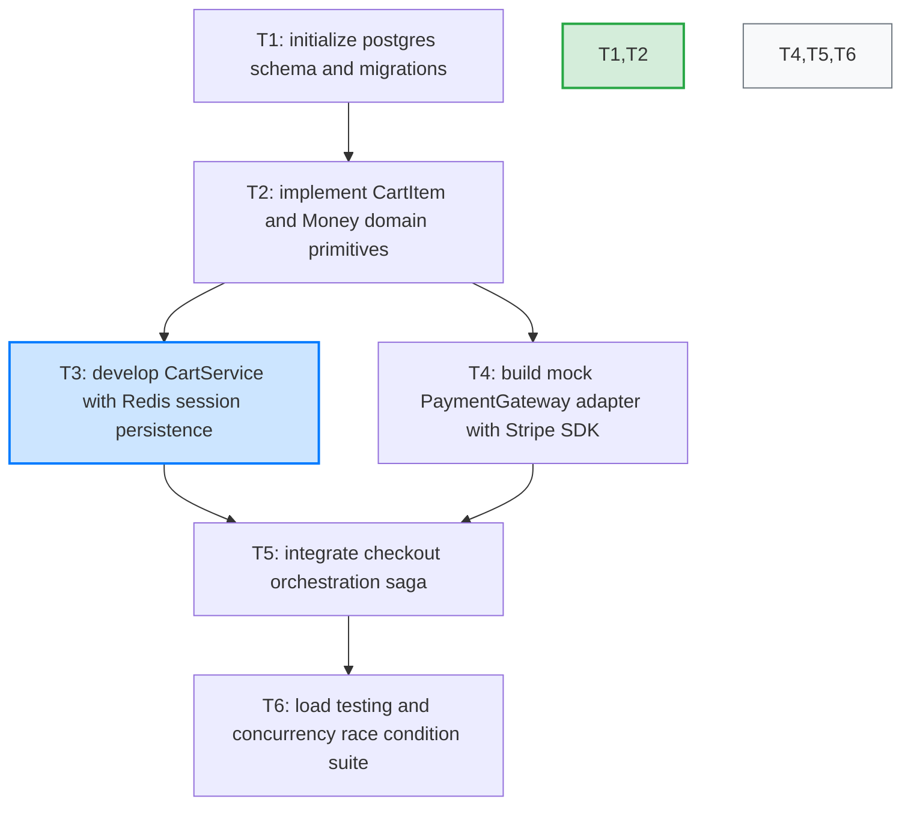

# commerce-engine

### Project Metadata
| Key | Value |
| :--- | :--- |
| **app** | `commerce-engine` |
| **arch** | `event-driven` |
| **runtime** | `py311` |

## Architectural Principles & Constraints

- **[Rationale: `store`]**: PostgreSQL chosen for ACID compliance on order ledger
- **[Rationale: `cache`]**: Redis key-expiration handles cart session eviction automatically
- **[Constraint: `payment`]**: Idempotency-Key header mandatory on all transaction mutations
- **[Constraint: `security`]**: PCI compliance: raw card data never touches internal microservices
- **[Invariant: `currency`]**: Monetary values strictly stored as integer cents

## Type Contracts

```typescript
type Money = { cents: int, curr: "USD" | "EUR" | "GBP" };
type CartItem = { sku: str, qty: int, price: Money };
type Order = { id: str, user_id: str, items: CartItem[], total: Money, status: str };
```

## Service Interfaces

### `interface CartService`
```typescript
  addItem(cart_id: str, item: CartItem) -> bool;
  checkout(cart_id: str, idempotency_key: str) -> Order | Err(409);
```

### `interface PaymentGateway`
```typescript
  charge(order_id: str, amount: Money, token: str) -> bool | Err(402);
  refund(order_id: str) -> bool;
```

## Execution Plan & Task DAG

- [x] **T1**: initialize postgres schema and migrations *(Done)*
- [x] **T2**: implement CartItem and Money domain primitives *(Done)* `after: T1`
- [ ] **T3**: develop CartService with Redis session persistence *(In Progress)* `after: T2`
- [ ] **T4**: build mock PaymentGateway adapter with Stripe SDK *(Pending)* `after: T2`
- [ ] **T5**: integrate checkout orchestration saga *(Pending)* `after: T3, T4`
- [ ] **T6**: load testing and concurrency race condition suite *(Pending)* `after: T5`

### Dependency Graph


